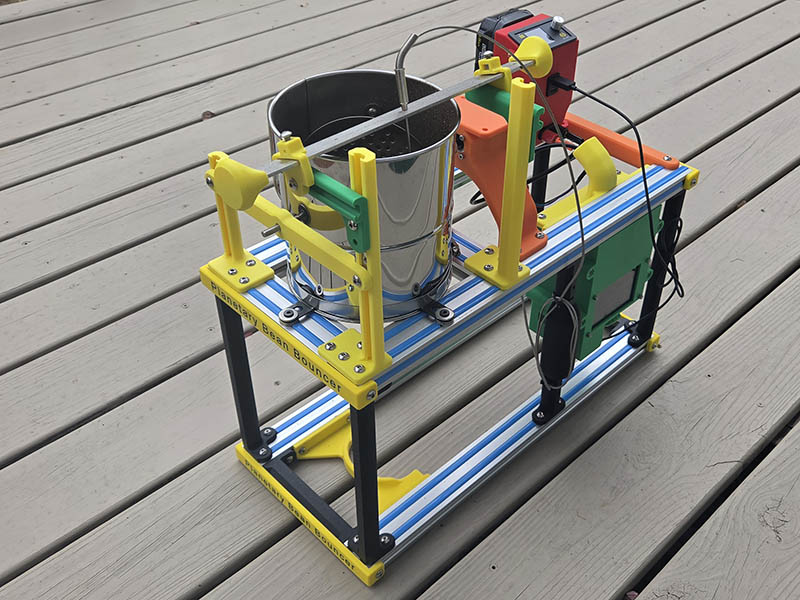

# Planetary Bean Bouncer

An open-source DIY coffee roaster built around an 8-cup stainless steel flour sifter, a planetary gear-driven agitator, and a stationary heat gun. The Planetary Bean Bouncer combines 3D-printed mechanical components, readily available hardware, and custom electronics to create an affordable small-batch coffee roasting platform.

> ⚠️ **Safety notice:** This project involves high temperatures, mains-powered equipment, and moving mechanical parts. Read `DISCLAIMER.md` before building or operating the roaster.

## Overview

The Planetary Bean Bouncer (PBB) is a small-batch coffee roaster designed around a modified stainless steel flour sifter. A planetary gear mechanism drives the agitator, continuously moving the beans while heat is applied by a stationary heat gun.

The project has evolved through several prototypes, with improvements to the mechanical assembly, electronics, firmware, and user interface.

There are currently two controller versions of the Planetary Bean Bouncer:

- **Arduino Version:** The original, lower-cost electronics design using an Arduino controller and a 1602 LCD display. This version remains fully functional and is a good choice for builders looking for a simpler and less expensive electronics package.
- **ESP32-S3 Version:** An updated controller featuring a custom-designed PCB, 4-inch TFT touchscreen, real-time clock, and SD card roast data logging. It provides a more advanced user interface and additional monitoring capabilities.

Both versions use the same basic roasting concept and mechanical platform. The ESP32-S3 version also incorporates several mechanical refinements.

This repository contains the firmware, hardware designs, 3D-printable parts, bill of materials, and documentation needed to build and experiment with the Planetary Bean Bouncer.

## Features

- Planetary gear-driven rotating agitator
- Stationary heat gun for bean heating
- Two controller options: Arduino and ESP32-S3
- Adjustable stepper motor speed
- Temperature monitoring using a K-type thermocouple
- Arduino version with 1602 LCD interface
- ESP32-S3 version with 4-inch TFT touchscreen
- DS3231 real-time clock on the ESP32-S3 version
- SD card roast data logging on the ESP32-S3 version
- Audible alerts and roast monitoring
- 3D-printed mechanical components

## Project Status

Both the Arduino and ESP32-S3 versions are functional.

The original Arduino version remains a reliable and less expensive option. The ESP32-S3 version represents the latest development, with updated electronics, a touchscreen interface, roast data logging, and several mechanical refinements.

The build guide, bill of materials, and controller documentation are being maintained as the project continues to develop.

## Repository Contents

The repository contains the following main sections:

- `firmware/` — Controller firmware for the supported versions.
- `hardware/` — Mechanical designs, STL files, and hardware reference information.
- `wiring/` — Wiring references and diagrams.
- `docs/` — Build guides, bill of materials, FAQ, and other documentation.
- `PBB_ESP32_S3/` — Updated ESP32-S3 controller design files and associated resources.
- `media/` — Project photographs and videos.

The original hardware directory retains the earlier mechanical designs, including the fully 3D-printed planetary gearbox. The ESP32-S3 directory contains the updated mechanical parts and electronics designs.

Refer to the current build guide and BOM when selecting parts for the ESP32-S3 version.

## Mechanical Design Updates

Several mechanical changes were made as the design evolved.

### Agitator Shaft

The original design used a 5 mm shaft. The stainless steel 3D-printed wobble disc was subsequently drilled out to 6 mm, and this larger shaft has been holding well under the operating load.

The updated 3D-printed shaft design, with a 6.5 mm clearance hole, is included in the ESP32-S3 directory.

### Planetary Gearbox

The original design used a completely 3D-printed planetary gearbox. This design remains available in the original hardware directory for builders who prefer to print their own gearbox.

The ESP32-S3 version uses a commercially manufactured planetary gear assembly. This reduces the number of printed parts considerably and simplifies construction.

Both approaches are valid, and builders can choose the arrangement that best suits their needs.

## Hardware Overview

The Planetary Bean Bouncer uses a modified 8-cup stainless steel flour sifter, a planetary gear mechanism, a NEMA 17 stepper motor, and a stationary consumer heat gun.

The electronics depend on the controller version selected.

### Arduino Version

- Arduino Uno or compatible controller
- Stepper motor driver, such as DRV8825 or TMC2209
- NEMA 17 stepper motor
- MAX6675 thermocouple interface
- 1602 LCD display
- Push-button controls

This version provides the basic motor control and temperature monitoring functions at a lower electronics cost.

### ESP32-S3 Version

- ESP32-S3 development module
- Custom-designed controller PCB
- 4-inch TFT touchscreen
- Integrated stepper motor driver circuitry
- MAX6675 thermocouple interface
- DS3231 real-time clock
- SD card storage
- Audible alerts

### Alternative ESP32-S3 Development Board

The custom ESP32-S3 controller PCB is not required to build the ESP32-S3 version. During development, I also used an inexpensive 44-pin ESP32-S3 N16R8 development board with a GPIO expansion board.

This provides an alternative for builders who prefer a prototype-style electronics assembly rather than manufacturing the custom controller PCB.

The N16R8 version provides 16 MB flash and 8 MB PSRAM. Boards are available with either an onboard antenna or an external antenna connector.

**Important compatibility note:** If you plan to install an ESP32-S3 development board directly onto the custom controller PCB, check the spacing between the two rows of header pins before purchasing. The custom PCB accommodates two pin-spacing options: 0.9 inches and 1.0 inches. Some development boards use 1.1-inch spacing and will not fit.

Using a separate GPIO expansion board, like the one included with my prototype, avoids this physical spacing limitation.

These development boards are available from multiple sellers and may have hardware revisions or differences in their power circuitry. My prototype required a solder-pad modification to provide 5V at the board's 5V connection, and occasionally required a second boot attempt. Verify the board's power connections and operation before incorporating it into the roaster.

Follow the ESP32-S3 wiring diagram for GPIO assignments and peripheral connections. Not every development board will have identical hardware.

Refer to the corresponding build documentation and bill of materials for component details, wiring, and assembly information.

## Build Guide and Bill of Materials

Build documentation and a bill of materials are provided in the `docs/` directory.

The build guide covers mechanical construction, electronics, wiring, and controller setup. The BOM identifies the components and hardware needed for the build.

Make sure to use the documentation corresponding to the controller version you intend to build.

## Fit & Tolerance Test Prints

Two optional test STLs are included to verify printer tolerances before printing the main components:

- **`hardware/STL/accessories/Test_1.stl`** – Verifies screw, nut, bearing, and lever-lock electrical terminal fits.
- **`hardware/STL/accessories/Gearing_5_1_16_24_64_Test_Rev36.stl`** – A reduced-size planetary gear set using the same tolerances as the full 3D-printed gearbox. It can also be used as a fidget.

These test prints are highly recommended if your printer or filament has not been tested with the design.

See `docs/tolerance-test-prints.md` for additional details.

## Quick Start

Before building:

1. Read `DISCLAIMER.md` and the project FAQ.
2. Decide whether you want to build the Arduino or ESP32-S3 version.
3. Review the appropriate build guide and bill of materials.
4. Review the corresponding hardware and STL directories.
5. Obtain and assemble the required mechanical and electronic components.
6. Follow the firmware instructions for your selected controller.
7. Test motor operation, temperature monitoring, and controller functions without applying heat.
8. Complete the assembly and perform appropriate safety checks before roasting.

## ESP32-S3 PCB Design and Gerber Files

The repository includes the KiCad project files and Gerber files for the custom ESP32-S3 controller board.

The supplied Gerber files retain the decorative back silkscreen image used on the manufactured board. The image was intentionally removed from the published KiCad source files to reduce file size and avoid image-clipping warnings.

Builders can use the supplied Gerbers to manufacture the board as designed, or modify the KiCad project and generate their own Gerbers.

## Licensing

This project uses multiple licenses:

- **Firmware:** MIT License
- **Hardware design files (STL, images, diagrams):** Creative Commons Attribution-NonCommercial 4.0 International (CC BY-NC 4.0)

The hardware license allows free personal and educational use while restricting commercial use without permission.

See the individual license files for details.

## Support This Project ☕

This project is released as open source and free to use.

If you find it useful and would like to support continued development, documentation, and future improvements, you can:

☕ **Buy me a coffee:** https://buymeacoffee.com/geodave

Support is entirely optional, but always appreciated.

## Credits

Project design and implementation: **David Bunch**

Firmware was developed with AI-assisted code generation and subsequently reviewed, tested, and maintained by the author.

Some components and design elements are derived from existing open-source projects and are credited in the relevant subdirectories.

## Build Log and Videos

The Planetary Bean Bouncer has been developed and documented over time through videos and a long-running build discussion.

### YouTube Playlist

A playlist documenting the design, prototyping, testing, and development of the Planetary Bean Bouncer:

https://www.youtube.com/playlist?list=PLyy5iFdDEfauqgzqg_eptvup8FIkFzkNk

New videos may be added as the project continues to evolve.

### Build Log

A detailed build log and discussion thread dating back to September 2025, including design decisions, experiments, and lessons learned:

https://forum.v1e.com/t/diy-coffee-roaster/51195

These resources provide additional background and context beyond what is included in the repository.

## FAQ

Common questions about build difficulty, food safety, and project scope are answered here:

➡️ [docs/FAQ.md](docs/FAQ.md)